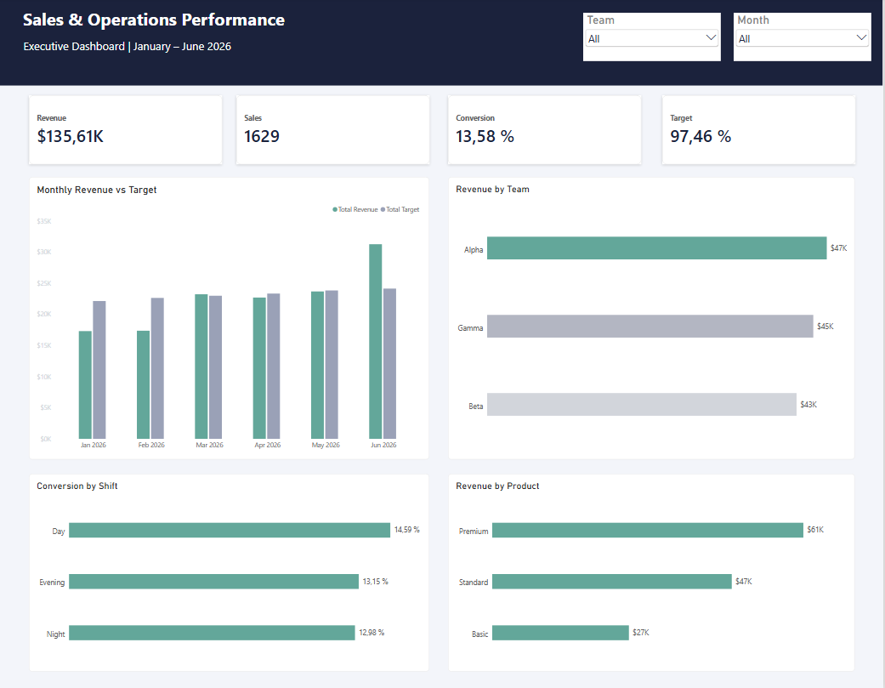

# Sales Operations Analysis | SQL & Power BI

**An end-to-end sales performance analysis project using PostgreSQL, SQL, DAX, and Power BI.**

## Dashboard Preview

## Project Overview

This project analyzes 12,000 synthetic sales interactions recorded between January and June 2026.

The objective is to evaluate sales performance, identify operational trends, compare team productivity, and measure sales target achievement.

The project demonstrates the process of transforming structured business data into actionable insights through relational database modeling, SQL analysis, and interactive business intelligence reporting.

## Tools & Technologies

- **PostgreSQL:** Relational database management
- **DBeaver:** Database administration and SQL development
- **SQL:** Joins, aggregations, CTEs, CASE expressions, and business analysis
- **Power BI:** Data modeling, dashboards, and visualizations
- **DAX:** Dynamic KPI measures and calculations

## Business Questions

1. How much revenue did the business generate?
2. Which teams performed best in revenue and conversion?
3. How did monthly sales compare against targets?
4. Which interaction channels and shifts performed most efficiently?
5. Which product segments generated the most revenue?

## Key Performance Indicators

| KPI | Result |
|---|---:|
| Total Interactions | 12,000 |
| Total Sales | 1,629 |
| Total Revenue | $135,610.59 |
| Conversion Rate | 13.58% |
| Overall Target Achievement | 97.46% |

## Key Findings

### 1. Monthly Performance

June 2026 was the strongest month, generating **$31,280.70** in revenue and achieving **129.53%** of its sales target.

Conversion rate improved from 10.59% in January to 17.35% in June.

### 2. Team Performance

Team Alpha generated the highest revenue at **$47,229.75**.

However, Team Gamma achieved the highest target attainment at **100.45%**, demonstrating the importance of evaluating performance against established goals rather than revenue alone.

### 3. Sales Channels

Outbound interactions achieved a **16.42% conversion rate**, compared with 11.62% for Inbound interactions.

This suggests an opportunity to investigate differences in channel effectiveness and customer engagement.

### 4. Product Performance

The Premium segment generated **$61,383.44** in revenue, supported by a higher average sale value than the Standard and Basic segments.

## Dashboard Features

The Power BI dashboard includes:

- Total Revenue, Sales, Conversion Rate, and Target Achievement KPIs
- Monthly Revenue vs Target comparison
- Revenue by Team
- Conversion by Shift
- Revenue by Product
- Interactive filters for Month and Team

The dashboard uses DAX measures and relational data modeling to dynamically recalculate metrics based on user selections.

## Repository Structure

- `data/cleaned/` — Prepared CSV datasets
- `sql/01_database_setup.sql` — Database and table definitions
- `sql/02_business_analysis.sql` — Business analysis queries
- `powerbi/` — Power BI dashboard file
- `images/` — Dashboard screenshot
- `documentation/` — Dataset notes

 ## How to Reproduce This Project

1. Install PostgreSQL, DBeaver, and Power BI Desktop.
2. Connect to the default PostgreSQL database and create a new database named `sales_operations`.
3. Connect to `sales_operations` and execute the `CREATE TABLE` statements in `sql/01_database_setup.sql`.
4. Import the CSV files into their corresponding tables in this order:
   - `agents.csv` → `agents`
   - `sales_targets_clean.csv` → `sales_targets`
   - `sales_interactions_clean.csv` → `sales_interactions`
5. After importing the data, execute the sales target recalibration `UPDATE` statement at the end of `01_database_setup.sql` **once only**.
6. Execute the queries in `sql/02_business_analysis.sql` to reproduce the business analysis.
7. Open `powerbi/sales_operations_dashboard.pbix` in Power BI Desktop to explore the interactive dashboard.

**Note:** The dashboard uses imported data. Refreshing from PostgreSQL requires configuring the local database connection. The target recalibration statement must not be executed repeatedly.

## Business Recommendations

- Investigate the operational practices associated with June's improved conversion performance.
- Evaluate revenue and target achievement together when comparing teams.
- Examine the drivers of Outbound channel conversion performance.
- Explore opportunities to improve Premium product performance and customer engagement.

## Data Disclaimer

This project uses **synthetic data for educational and portfolio purposes**. The results do not represent actual company performance.

## Author

**FREY-007**

Data Analytics Portfolio | SQL · PostgreSQL · Power BI
